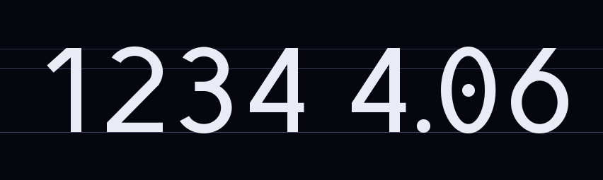

# Heliopause

A geometric sans with a cosmic twist, designed by xKid for [xkid.org](https://xkid.org). Calm enough for long reading, cosmic in the details. Every glyph is drawn in code, so all three weights come from the same construction.



**v0.7** · Regular, SemiBold, Bold · [SIL Open Font License 1.1](OFL.txt)

## What's inside

| Folder | Contents | Use it for |
| --- | --- | --- |
| `otf/` | Regular, SemiBold, Bold as `.otf` | Installing on Mac or Windows, Figma and other design apps |
| `ttf/` | The same three weights as `.ttf` | Installing anywhere |
| `web/` | `.woff2` files, `heliopause.css`, `specimen.html` | Websites |
| `source/` | The Python scripts that draw and build the fonts | Changing the design |

## Use it on the web

1. Copy the `web/` folder into your site, for example to `/fonts/heliopause/`.
2. Link the stylesheet:
   ```html
   <link rel="stylesheet" href="/fonts/heliopause/heliopause.css">
   ```
3. Set the font:
   ```css
   body { font-family: 'Heliopause', system-ui, sans-serif; }
   ```

Weights: 400 Regular, 600 SemiBold, 700 Bold. Open `web/specimen.html` in a browser to see the whole family.

## OpenType features

| Feature | What it does |
| --- | --- |
| `ss02` | Plain zero (the default 0 has a planet dot inside) |
| `ss03` | Plain x without the orbital cross, for code and math |
| `ss04` | Orbit O, a capital O with a planet dot inside |
| `kern` | Kerning for common pairs (on by default) |

Figures and the currency signs `$ € £ ₹` are tabular by default, so clocks, counters and price columns never jitter.

## Installing on a Mac

When updating to a new version:

1. Open Font Book, search for Heliopause, and remove every old copy.
2. Install only the `.otf` files. Installing `.otf` and `.ttf` together makes them clash.
3. Quit and reopen Figma so it reloads the fonts.

In Figma, the alternates live in Type settings → Details → Stylistic sets.

## Character set

A–Z, a–z, 0–9 and all of printable ASCII, including `& $ { } ~ ^` and the backtick. On top of that: the currency signs `€ £ ₹`, `¡ ¿ « » ‹ ›`, curly quotes, dashes, `× ° · • …` and the arrows `← ↑ → ↓`.

Accented letters aren't included: Heliopause is drawn for English.

## Building from source

You need Python 3 with [fontTools](https://github.com/fonttools/fonttools), and Node.js. WOFF2 compression uses Node's built-in brotli through `source/shim/`, so the Python brotli package isn't required.

```sh
pip install fonttools
python3 source/build.py    # writes otf/, ttf/ and web/*.woff2
```

To render proof sheets (glyph grids and text samples) into `proofs/`:

```sh
pip install pillow
python3 source/proof.py
```

The fonts in `otf/`, `ttf/` and `web/` are build outputs. They're committed so anyone can use the font without building it. When you change anything in `source/`, rebuild and commit the fonts in the same commit.

## License

Copyright 2026 xKid. Heliopause is licensed under the [SIL Open Font License 1.1](OFL.txt). You can use it in personal and commercial work, embed it in apps and websites, modify it, and redistribute it. The one thing you can't do is sell the font files on their own.
