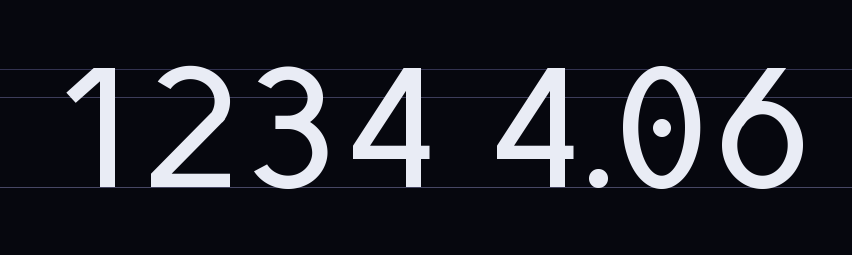

# Heliopause

A geometric sans with a cosmic twist, designed by xKid for [xkid.org](https://xkid.org). Calm enough for long reading, cosmic in the details. Every glyph is drawn in code, so all three weights come from the same construction.

**Heliopause Mono** is its monospaced sibling for code and terminals, drawn by the same code and fitted to a fixed grid. See [Heliopause Mono](#heliopause-mono) below.



**v0.8** · Regular, SemiBold, Bold, for both Heliopause and Heliopause Mono · [SIL Open Font License 1.1](OFL.txt)

## What's inside

| Folder | Contents | Use it for |
| --- | --- | --- |
| `otf/` | Regular, SemiBold, Bold as `.otf`, for both families | Installing on Mac or Windows, Figma and other design apps |
| `ttf/` | The same files as `.ttf` | Installing anywhere |
| `web/` | `.woff2` files, `heliopause.css`, `heliopause-mono.css` and a specimen page for each family | Websites |
| `source/` | The Python scripts that draw and build the fonts | Changing the design |

## Use it on the web

1. Copy the `web/` folder into your site, for example to `/fonts/heliopause/`.
2. Link the stylesheet:
   ```html
   <link rel="stylesheet" href="/fonts/heliopause/heliopause.css">
   ```
3. Set the font:
   ```css
   body { font-family: 'Heliopause', system-ui, sans-serif; }
   ```

Weights: 400 Regular, 600 SemiBold, 700 Bold. Open `web/specimen.html` in a browser to see the whole family.

## OpenType features

| Feature | What it does |
| --- | --- |
| `ss02` | Plain zero (the default 0 has a planet dot inside) |
| `ss03` | Plain x without the orbital cross, for code and math |
| `ss04` | Orbit O, a capital O with a planet dot inside |
| `kern` | Kerning for common pairs (on by default) |

Figures and the currency signs `$ € £ ₹` are tabular by default, so clocks, counters and price columns never jitter.

## Heliopause Mono

Every character is exactly one cell wide (600 units), so code lines up in columns. It has the same character set and stylistic sets as Heliopause, including the dotted zero and the orbital-cross x. It has no kerning, since a monospace can't kern.

Where Heliopause relies on context, the mono disambiguates:

- **l** ends in an orbit foot.
- **i** and **1** stand on a bar.
- **I** has top and bottom slabs.
- **0** keeps its planet dot.

### In your editor

VS Code (`settings.json`):

```json
"editor.fontFamily": "'Heliopause Mono', monospace",
"editor.fontLigatures": true
```

Most terminals and editors list it as **Heliopause Mono** once the `.otf` files are installed.

### On the web

```html
<link rel="stylesheet" href="/fonts/heliopause/heliopause-mono.css">
```
```css
code, pre { font-family: 'Heliopause Mono', ui-monospace, monospace; }
```

Open `web/specimen-mono.html` to see it, with a switch that turns the ligatures off.

### Code ligatures

These are in `calt`, which is on by default:

`->` `<-` `<->` `=>` `<=>` `>=` `<=` `==` `===` `!=` `!==` `::` `|>` `<|`

Each ligature still occupies one cell per character, so the cursor and the column count are unaffected. A ligature never fires next to another operator character, so `<!--`, `-->`, `====` and `>>=` stay as plain characters.

To turn ligatures off, use your editor's ligature setting, or on the web `font-variant-ligatures: none` (the `.no-ligatures` class in `heliopause-mono.css`).

## Installing on a Mac

When updating to a new version:

1. Open Font Book, search for Heliopause, and remove every old copy.
2. Install only the `.otf` files. Installing `.otf` and `.ttf` together makes them clash.
3. Quit and reopen Figma so it reloads the fonts.

In Figma, the alternates live in Type settings → Details → Stylistic sets.

## Character set

A–Z, a–z, 0–9 and all of printable ASCII, including `& $ { } ~ ^` and the backtick. On top of that: the currency signs `€ £ ₹`, `¡ ¿ « » ‹ ›`, curly quotes, dashes, `× ° · • …` and the arrows `← ↑ → ↓`.

Accented letters aren't included: Heliopause is drawn for English.

## Building from source

You need Python 3 with [fontTools](https://github.com/fonttools/fonttools), and Node.js. WOFF2 compression uses Node's built-in brotli through `source/shim/`, so the Python brotli package isn't required.

```sh
pip install fonttools
python3 source/build.py         # both families: writes otf/, ttf/ and web/*.woff2
python3 source/build.py mono    # only Heliopause Mono (or `sans` for only Heliopause)
python3 source/check_mono.py    # checks the mono: one cell per glyph, ligatures, metadata
```

To render proof sheets (glyph grids and text samples) into `proofs/`:

```sh
pip install pillow
python3 source/proof.py         # both families (or `mono` / `sans`)
```

The mono's sources are `source/mono.py` (its cell, widths and redrawn letters) and `source/ligatures.py`. The mono reuses every construction in `source/glyphs.py`; dimensions that set a letter's width are read through `P.w()`, which Heliopause leaves at their defaults and the mono replaces from its own width table.

The fonts in `otf/`, `ttf/` and `web/` are build outputs. They're committed so anyone can use the font without building it. When you change anything in `source/`, rebuild and commit the fonts in the same commit.

## License

Copyright 2026 xKid. Heliopause and Heliopause Mono are licensed under the [SIL Open Font License 1.1](OFL.txt). You can use it in personal and commercial work, embed it in apps and websites, modify it, and redistribute it. The one thing you can't do is sell the font files on their own.
